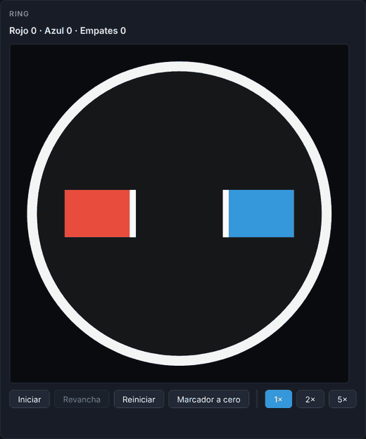

# Sumo Sim

Simulador de combate de sumo para robots **LEGO EV3**. Programas tu robot con bloques visuales, lo enfrentas a otro y miras la pelea en un ring a escala.

**[Probar la demo](https://jose-an608.github.io/sumo-sim/)** · funciona en el navegador, sin instalar nada.



*Un combate real de la demo: el robot rojo, programado con bloques, contra el azul con la estrategia automática.*

## Qué se puede hacer

- **Programar con bloques** (Blockly): avanzar, girar, detener, repetir siempre, y condiciones por distancia al rival o por borde del ring.
- **Dos robots, dos editores**: una pestaña para el rojo y otra para el azul. El azul usa por defecto una estrategia automática ("Automático") y puede cambiarse a su propio programa ("Sus bloques").
- **Ver el combate** en un canvas con el ring de 77 cm de diámetro, a velocidad 1x, 2x o 5x.
- **Llevar el marcador** de la sesión (rojo, azul y empates) y pedir revancha.
- **Guardar tu programa**: se autoguarda en el navegador, y también se puede descargar y volver a abrir como archivo `.json`.

<!-- Si el C3 (estrategias de ejemplo) y el C4 (botón de pseudocódigo) entran antes
     de la entrega, agregar aquí dos viñetas más. Hoy la conversión a pseudocódigo
     existe como módulo (src/blocks/pseudocodigo.ts) pero todavía no tiene botón. -->

## Cómo correrlo

Necesitas [Node.js](https://nodejs.org) reciente (el CI y el despliegue usan la versión 20).

```bash
git clone https://github.com/Jose-An608/sumo-sim.git
cd sumo-sim
npm install
npm run dev        # servidor local con recarga automática
```

Otros comandos:

| Comando | Qué hace |
|---|---|
| `npm test` | Corre los tests (Vitest) |
| `npm run coverage` | Tests con informe de cobertura (se genera `coverage/index.html`) |
| `npm run build` | Comprueba tipos y construye la versión publicable en `dist/` |
| `npm run preview` | Sirve lo construido, tal como queda en GitHub Pages |

## Cómo está hecho

El programa de bloques pasa por una cadena corta, y cada pieza se puede probar sola:

```
bloques (Blockly) → generator → Instruccion[] → VM → velocidades de rueda → física → canvas
```

| Carpeta | Responsabilidad |
|---|---|
| `src/blocks/` | Definición de bloques, compilación a instrucciones, guardado y pseudocódigo |
| `src/vm/` | Máquina virtual que ejecuta las instrucciones un cuadro a la vez |
| `src/engine/` | Física, sensores, bucle de simulación y marcador |
| `src/render/` | Dibujo en canvas |
| `src/types.ts` | El contrato compartido entre todas las capas |

### Decisiones de diseño

- **El contrato primero.** `types.ts` se definió el primer día y las dos personas trabajaron contra él sin esperarse. Por eso la VM se prueba sin simulador: se le pasan lecturas de sensores inventadas y se comprueban las órdenes que devuelve.
- **Paso de tiempo fijo.** La simulación avanza en pasos de 1/60 s, sin importar la velocidad del monitor. Así el mismo programa produce el mismo combate en cualquier computadora, y acelerar la simulación es solo ejecutar más pasos por cuadro.
- **Cinemática diferencial.** Cada robot se mueve con dos velocidades de rueda; la velocidad angular sale de `w = (vL − vR) / anchoEje`. Es el mismo modelo que gobierna un EV3 real.
- **Los límites del motor son los del robot real.** Las órdenes se recortan a 50 cm/s (motor grande EV3 con rueda estándar). El simulador no deja que una estrategia gane con algo que el robot físico no puede hacer.
- **Las condiciones no gastan tiempo, los movimientos sí.** Un `si` se resuelve en el mismo cuadro; un `avanzar` dura lo que dice. Un `repetir siempre` vacío no cuelga la página: hay un límite de instrucciones de control por cuadro.
- **Archivos ajenos no borran tu trabajo.** Al abrir un `.json`, se rechaza todo lo que no tenga forma de programa de bloques, y el programa actual queda intacto.

### Pruebas

Se desarrolló con TDD en la lógica: primero el test que falla, después el código. Hay **131 tests**. La lógica (`engine/`, `vm/`, `blocks/`) está entre 93% y 100% de líneas cubiertas. Además, se rompió código a propósito en varias ocasiones para comprobar que los tests fallan cuando deben.

## Alcance y límites

Lo que **no** hace, a propósito o por tiempo:

- No simula motores reales: sin inercia, derrape ni baterías. Un programa que gana aquí puede perder en el robot físico.
- Los sensores son ideales: sin ruido ni errores de lectura.
- Solo dos robots, y siempre en el mismo ring.
- La interfaz (`main.ts`, `workspace.ts`) y el dibujo (`canvas.ts`) se verificaron a mano; tienen 0–9% de cobertura automática porque dependen del navegador.
- El marcador mezcla resultados si cambias los bloques entre rondas; usa "Marcador a cero" para empezar limpio.
- Pensado para pantalla de computadora: en celular abre, pero el editor queda apretado.
- El paquete de Blockly pesa unos 758 kB y Vite avisa de ello al construir.

## Cómo trabajamos

Dos personas, trunk-based: una rama corta por issue, PR revisado por la otra persona y nadie mergea el suyo. Los detalles están en [CONTRIBUTING.md](CONTRIBUTING.md). La retrospectiva del proyecto está en [docs/retrospectiva.md](docs/retrospectiva.md).

## Autores

[José](https://github.com/Jose-An608) y [Chura](https://github.com/Cristhian-Ch).

## Licencia

MIT. Ver [LICENSE](LICENSE).
